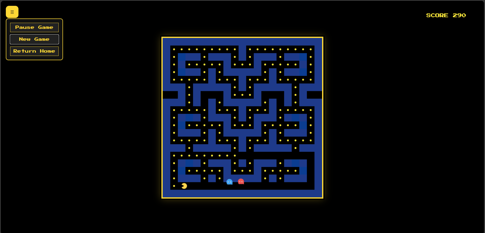
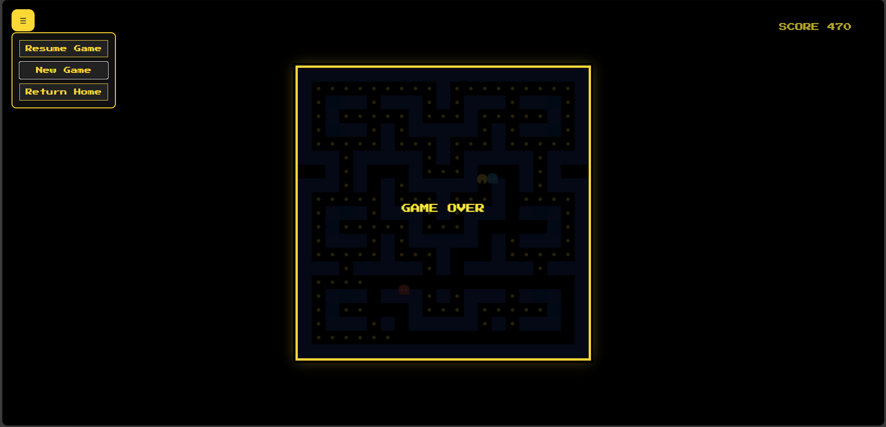

# PacmanGame

A browser-based Pac-Man game built with **Vue 3**, **Vuex** and **Vite**. Pick a difficulty level, collect every pellet, and avoid the ghosts that chase you through the maze.

## Overview

The game has two screens:

- **Home** – choose a difficulty (Easy, Medium or Hard).
- **Game** – play on a 21x21 maze drawn on an HTML canvas, with a live score, a pause menu and win/lose screens.

## Screenshots

### Gameplay


### Win screen


### Game over screen


## Features

- Three difficulty levels that set the number of ghosts:

  | Level  | Ghosts |
  | ------ | ------ |
  | Easy   | 2      |
  | Medium | 3      |
  | Hard   | 5      |

- Ghosts with a chase AI: they roam the maze and head straight for Pac-Man when he gets close
- Safe zones that Pac-Man can enter but ghosts cannot
- Score tracking (10 points per pellet)
- Pause and resume from the in-game menu or with the `Esc` key
- Win and lose screens with sound effects
- Animated Pac-Man mouth and ghosts
- Global game state managed with Vuex (difficulty, score, pause state, game status)
- Page navigation with Vue Router

## Controls

| Key            | Action                |
| -------------- | --------------------- |
| Arrow keys     | Move Pac-Man          |
| `Esc`          | Pause / resume        |
| `☰` menu button | Pause / resume / menu |

## Tech Stack

- Vue 3
- Vuex 4
- Vue Router 4
- Vite 5
- JavaScript, HTML Canvas, CSS

## Project Structure

```
src/
├── assets/        # styles, game icon, win/lose sound effects
├── router/        # Home and Game routes
├── store/         # Vuex store (difficulty, score, pause, game status)
├── views/
│   ├── Home.vue   # difficulty selection screen
│   └── Game.vue   # maze, Pac-Man, ghosts, scoring, game loop
├── App.vue
└── main.js
```

## Getting Started

1. Clone the repository

   ```bash
   git clone https://github.com/Youstina-Raouf/Pacman-Game.git
   cd Pacman-Game
   ```

2. Install dependencies

   ```bash
   npm install
   ```

3. Start the development server

   ```bash
   npm run dev
   ```

4. Build for production

   ```bash
   npm run build
   npm run preview
   ```

## Team Members

- Youstina Raouf
- Chantal Sherif
